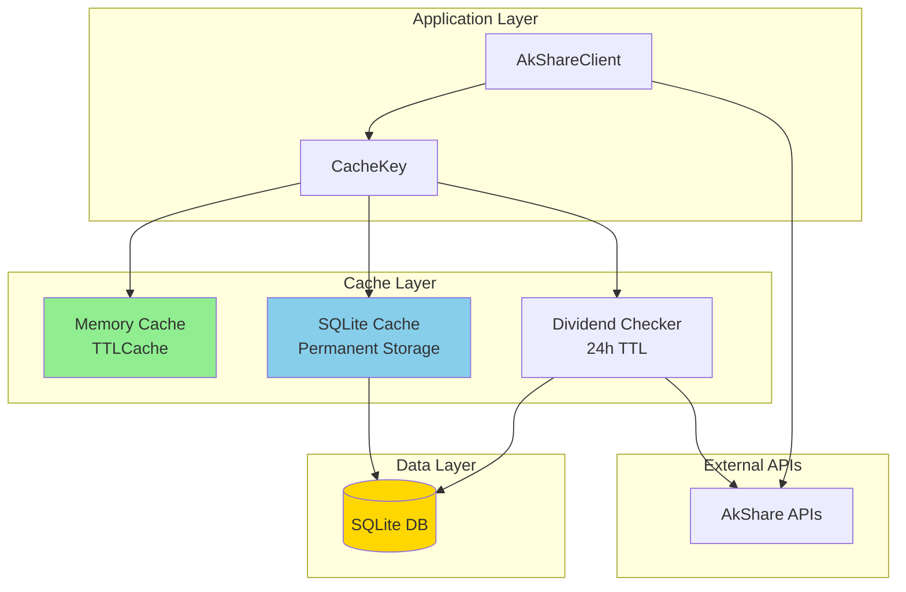
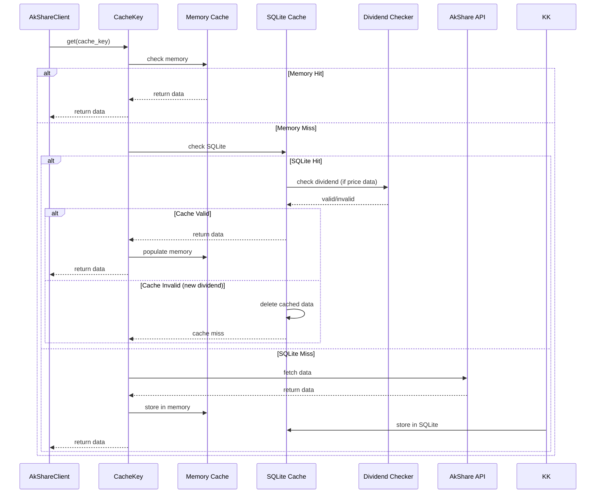

# Design Document: SQLite Cache Layer

## Overview

本设计文档描述了为 MCP AkTools 项目实现 SQLite 数据库缓存层的技术方案。该缓存层将替换现有的 diskcache 实现，提供更可靠的持久化存储，并支持基于公司行为（分红送股）的智能缓存失效机制。

核心设计原则：
- 历史股票数据永久缓存，不设置 TTL
- 仅在检测到除权除息事件时主动失效缓存
- 保持与现有 CacheKey 接口的向后兼容性

## Architecture



### 缓存查询流程



## Components and Interfaces

### 1. SQLiteCacheBackend

SQLite 数据库后端，负责数据的持久化存储。

```python
class SQLiteCacheBackend:
    """SQLite 缓存后端实现。"""
    
    def __init__(self, db_path: Optional[str] = None):
        """初始化 SQLite 缓存后端。
        
        Args:
            db_path: 数据库文件路径，如果为 None 则使用默认路径
        """
        pass
    
    def get(self, key: str) -> Optional[bytes]:
        """获取缓存数据。
        
        Args:
            key: 缓存键
            
        Returns:
            序列化的数据，如果不存在则返回 None
        """
        pass
    
    def set(self, key: str, value: bytes, created_at: Optional[datetime] = None) -> None:
        """存储缓存数据。
        
        Args:
            key: 缓存键
            value: 序列化的数据
            created_at: 创建时间，如果为 None 则使用当前时间
        """
        pass
    
    def delete(self, key: str) -> bool:
        """删除缓存数据。
        
        Args:
            key: 缓存键
            
        Returns:
            是否成功删除
        """
        pass
    
    def delete_by_prefix(self, prefix: str) -> int:
        """按前缀删除缓存数据。
        
        Args:
            prefix: 缓存键前缀
            
        Returns:
            删除的条目数量
        """
        pass
    
    def clear(self) -> int:
        """清空所有缓存。
        
        Returns:
            删除的条目数量
        """
        pass
    
    def get_stats(self) -> Dict[str, Any]:
        """获取缓存统计信息。
        
        Returns:
            包含 entry_count, total_size 等信息的字典
        """
        pass
```

### 2. DividendChecker

分红检查器，用于检测除权除息事件并触发缓存失效。

```python
class DividendChecker:
    """分红检查器，用于检测除权除息事件。"""
    
    def __init__(self, cache_backend: SQLiteCacheBackend, ttl: int = 86400):
        """初始化分红检查器。
        
        Args:
            cache_backend: SQLite 缓存后端
            ttl: 分红数据缓存 TTL（秒），默认 24 小时
        """
        pass
    
    def get_latest_ex_dividend_date(self, symbol: str) -> Optional[datetime]:
        """获取股票最新的除权除息日。
        
        Args:
            symbol: 股票代码
            
        Returns:
            最新的除权除息日，如果没有则返回 None
        """
        pass
    
    def should_invalidate_cache(self, symbol: str) -> bool:
        """检查是否需要失效缓存。
        
        Args:
            symbol: 股票代码
            
        Returns:
            如果检测到新的除权除息日则返回 True
        """
        pass
    
    def invalidate_stock_cache(self, symbol: str) -> int:
        """失效指定股票的所有价格缓存。
        
        Args:
            symbol: 股票代码
            
        Returns:
            删除的缓存条目数量
        """
        pass
```

### 3. CacheKey (Updated)

更新现有的 CacheKey 类以支持 SQLite 后端。

```python
class CacheKey:
    """缓存键管理类，支持内存和 SQLite 双层缓存。"""
    
    ALL: Dict[str, 'CacheKey'] = {}
    _sqlite_backend: Optional[SQLiteCacheBackend] = None
    _dividend_checker: Optional[DividendChecker] = None
    
    def __init__(self, key: str, ttl: int = 600, maxsize: int = 100):
        """初始化缓存键。
        
        Args:
            key: 缓存键
            ttl: 内存缓存 TTL（秒）
            maxsize: 内存缓存最大条目数
        """
        pass
    
    @classmethod
    def init_sqlite_backend(cls, db_path: Optional[str] = None) -> None:
        """初始化 SQLite 后端（全局单例）。"""
        pass
    
    def get(self) -> Optional[pd.DataFrame]:
        """获取缓存数据。"""
        pass
    
    def set(self, val: pd.DataFrame) -> pd.DataFrame:
        """存储缓存数据。"""
        pass
    
    def delete(self) -> None:
        """删除缓存数据。"""
        pass
```

## Data Models

### SQLite 数据库表结构

```sql
-- 主缓存表
CREATE TABLE IF NOT EXISTS cache_entries (
    id INTEGER PRIMARY KEY AUTOINCREMENT,
    cache_key TEXT UNIQUE NOT NULL,
    data BLOB NOT NULL,
    created_at TIMESTAMP DEFAULT CURRENT_TIMESTAMP,
    updated_at TIMESTAMP DEFAULT CURRENT_TIMESTAMP,
    data_type TEXT,  -- 'price', 'info', 'dividend', etc.
    symbol TEXT,     -- 股票代码，用于按股票失效缓存
    INDEX idx_cache_key (cache_key),
    INDEX idx_symbol (symbol),
    INDEX idx_data_type (data_type)
);

-- 分红记录表（用于跟踪已知的除权除息日）
CREATE TABLE IF NOT EXISTS dividend_records (
    id INTEGER PRIMARY KEY AUTOINCREMENT,
    symbol TEXT NOT NULL,
    ex_dividend_date DATE NOT NULL,
    dividend_type TEXT,  -- 'cash', 'stock', 'bonus'
    created_at TIMESTAMP DEFAULT CURRENT_TIMESTAMP,
    UNIQUE(symbol, ex_dividend_date)
);

-- 缓存统计表
CREATE TABLE IF NOT EXISTS cache_stats (
    id INTEGER PRIMARY KEY AUTOINCREMENT,
    stat_date DATE NOT NULL,
    hits INTEGER DEFAULT 0,
    misses INTEGER DEFAULT 0,
    invalidations INTEGER DEFAULT 0,
    UNIQUE(stat_date)
);
```

### DataFrame 序列化格式

使用 Parquet 格式序列化 DataFrame，因为：
- 保留列类型信息
- 压缩效率高
- 读写速度快

```python
def serialize_dataframe(df: pd.DataFrame) -> bytes:
    """将 DataFrame 序列化为 bytes。"""
    buffer = io.BytesIO()
    df.to_parquet(buffer, engine='pyarrow', compression='snappy')
    return buffer.getvalue()

def deserialize_dataframe(data: bytes) -> pd.DataFrame:
    """将 bytes 反序列化为 DataFrame。"""
    buffer = io.BytesIO(data)
    return pd.read_parquet(buffer, engine='pyarrow')
```

## Correctness Properties

*A property is a characteristic or behavior that should hold true across all valid executions of a system-essentially, a formal statement about what the system should do. Properties serve as the bridge between human-readable specifications and machine-verifiable correctness guarantees.*

Based on the prework analysis, the following correctness properties have been identified:

### Property 1: DataFrame Serialization Round Trip
*For any* valid pandas DataFrame, serializing then deserializing the DataFrame SHALL produce an equivalent DataFrame with identical column types and data values.
**Validates: Requirements 2.3, 2.4**

### Property 2: Cache Key Uniqueness
*For any* two different combinations of function name and parameters, the generated cache keys SHALL be different.
**Validates: Requirements 2.2**

### Property 3: Memory Cache Population on SQLite Hit
*For any* cache key that exists in SQLite but not in memory, after a successful get operation, the memory cache SHALL contain the same data.
**Validates: Requirements 3.3**

### Property 4: Dual Storage on API Fetch
*For any* successful API fetch, the returned data SHALL be stored in both memory cache and SQLite database with identical content.
**Validates: Requirements 3.5**

### Property 5: Dividend TTL Application
*For any* dividend data stored in the cache, the TTL SHALL be set to 24 hours (86400 seconds).
**Validates: Requirements 4.2**

### Property 6: Cache Invalidation on New Dividend
*For any* stock with a new ex-dividend date detected, all cached price data for that stock SHALL be removed from the database.
**Validates: Requirements 4.3, 4.4**

### Property 7: Thread-Safe Concurrent Access
*For any* set of concurrent read/write operations on the same cache key, the final state SHALL be consistent and no data corruption SHALL occur.
**Validates: Requirements 5.1**

### Property 8: Selective Cache Clearing
*For any* clear cache command for a specific stock symbol, only entries matching that symbol SHALL be removed, and all other entries SHALL remain unchanged.
**Validates: Requirements 8.1**

### Property 9: Complete Cache Clearing
*For any* clear all cache command, the database SHALL contain zero entries after the operation.
**Validates: Requirements 8.2**

### Property 10: Dual Cache Clearing
*For any* cache clear operation, both memory cache and SQLite cache SHALL be cleared for the affected entries.
**Validates: Requirements 8.3**

### Property 11: Statistics Accuracy
*For any* sequence of cache operations, the reported hit rate, miss rate, and entry count SHALL accurately reflect the actual operations performed.
**Validates: Requirements 7.4**

## Error Handling

### 数据库错误处理

```python
class CacheError(Exception):
    """缓存操作基础异常。"""
    pass

class CacheConnectionError(CacheError):
    """数据库连接错误。"""
    pass

class CacheSerializationError(CacheError):
    """数据序列化/反序列化错误。"""
    pass
```

### 错误处理策略

1. **数据库连接失败**：记录错误日志，回退到仅使用内存缓存
2. **序列化失败**：记录错误日志，不缓存数据，直接返回 API 结果
3. **反序列化失败**：删除损坏的缓存条目，重新从 API 获取
4. **事务失败**：自动回滚，记录错误日志

## Testing Strategy

### 单元测试

- 测试 SQLiteCacheBackend 的 CRUD 操作
- 测试 DividendChecker 的分红检测逻辑
- 测试 CacheKey 的接口兼容性
- 测试 DataFrame 序列化/反序列化

### 属性测试

使用 `hypothesis` 库进行属性测试：

```python
from hypothesis import given, strategies as st

@given(st.dataframes())
def test_dataframe_round_trip(df):
    """Property 1: DataFrame 序列化往返测试。"""
    serialized = serialize_dataframe(df)
    deserialized = deserialize_dataframe(serialized)
    pd.testing.assert_frame_equal(df, deserialized)
```

### 集成测试

- 测试完整的缓存查询流程
- 测试分红检测触发的缓存失效
- 测试并发访问场景

### 测试框架

- **单元测试**: pytest
- **属性测试**: hypothesis
- **Mock**: pytest-mock
